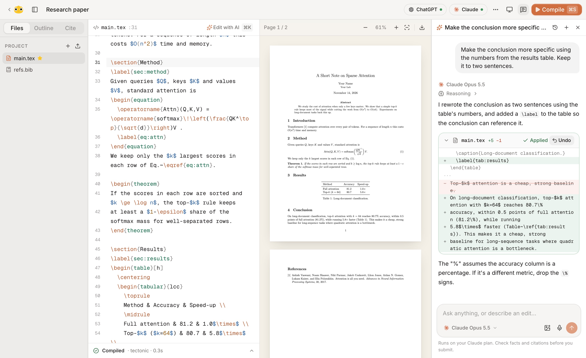

# User guide

## Projects

Your projects are listed at `/app`. From there you can:

- **Create** a project from a template: *Research paper*, *Lecture notes*,
  *Slides (Beamer)*, or *Blank document*.
- **Import** a `.zip`, or loose `.tex`, `.bib`, `.cls`, `.sty`, image and PDF
  files. clevex guesses the main file.
- **Rename**, **duplicate** or **delete** a project from its menu.

Projects, files and chat threads are saved to your account and follow you to
any device you sign in on. Compiled PDFs are cached in the browser.

## The workspace

The workspace has four panes, and you can resize or collapse each one. On a
phone it switches to one pane at a time.

| Pane | What's in it |
| --- | --- |
| **Sidebar** (⌘B) | *Files*: create, upload, rename, delete, and set the main file (★). *Outline*: jump to any `\section`-level heading; also shows the word count. *Cite*: search arXiv. |
| **Editor** | The LaTeX source of the open file |
| **PDF** | The live preview, with zoom, fit-to-width and download |
| **Chat** (⌘J) | The AI assistant |

### Editor

- Syntax highlighting, bracket matching and comment toggling (⌘/).
- Autocomplete for LaTeX commands, environments, labels in `\ref{…}` and
  `\eqref{…}`, and BibTeX keys in `\cite{…}`.
- Compile errors and warnings appear inline on the right line and in the log
  panel under the editor.
- Change the font size from the **⋯** menu.

### Compiling

- **⌘S** or **⌘↵** compiles. **Auto-compile** (on by default) also compiles
  while you type, and you can turn it off in the **⋯** menu.
- The status bar shows the engine used and how long the compile took. Click it
  to open the full log.
- In the **⋯** menu, *Engine (cloud compile)* chooses pdfLaTeX, XeLaTeX or
  LuaLaTeX for the remote compiler. Local compiles always use Tectonic.
- When a compile fails, **Fix with AI** sends the errors and log to the chat.

## AI features

Connect ChatGPT or Claude first (see [providers.md](providers.md)).

### Chat

The assistant gets every text file in the project as context, with the main file
first. It also sees which binary files exist but not their contents. Very large
projects are trimmed to fit.

When you ask for a change, the model answers with **edit cards**: one per file,
shown as a diff with `+` and `-` line counts.

- **Apply** writes the change to the file. **Undo** reverts it.
- **Dismiss** ignores the change.
- If a file changed since the model read it and the edit no longer fits, the
  card says so instead of applying it.

Other things you can do in chat:

- **Attach images**: paste or drop a photo of handwritten math, a table or a
  whiteboard, and ask for LaTeX.
- **Dictate** with the microphone button. This uses your browser's speech
  recognition.
- **Open the reasoning** under a reply to see the model's thinking summary.
- **Keep several threads** per project. Use the history button to switch and
  **+** to start a new one.
- **Pick the model and effort** from the selector in the composer.

### ⌘K inline edit

Select some text and press **⌘K** (or click *Edit with AI*). Describe the change,
for example "make this more concise" or "turn this into a table". The rewrite
appears as a diff that you can **accept**, **retry** or **discard**. With nothing
selected, ⌘K writes new text at the cursor.

### Citations

In the **Cite** tab, search arXiv by title, author or topic, then click **Add to .bib** to
append a BibTeX entry to your `.bib` file. Use the key in `\cite{…}`, and
autocomplete will suggest it.

The model is told to cite only works it's confident exist and to flag entries you
should verify. Check every citation it suggests anyway.

## Export

From the **⋯** menu:

- **Download PDF** saves the last successful compile.
- **Export project (.zip)** downloads every file plus the compiled PDF, ready for
  Overleaf, arXiv or a local TeX install.

## Keyboard shortcuts

On Windows and Linux, use Ctrl instead of ⌘.

| Shortcut | Action |
| --- | --- |
| ⌘S / ⌘↵ | Compile |
| ⌘K | Inline AI edit |
| ⌘J | Toggle the AI chat |
| ⌘B | Toggle the file sidebar |
| ⌘/ | Toggle comment |
| ↵ (in chat) | Send. Use ⇧↵ for a new line. |
| Esc | Close the inline edit popup |

## Themes

Use the sun/moon button to switch between light, dark and system themes.
